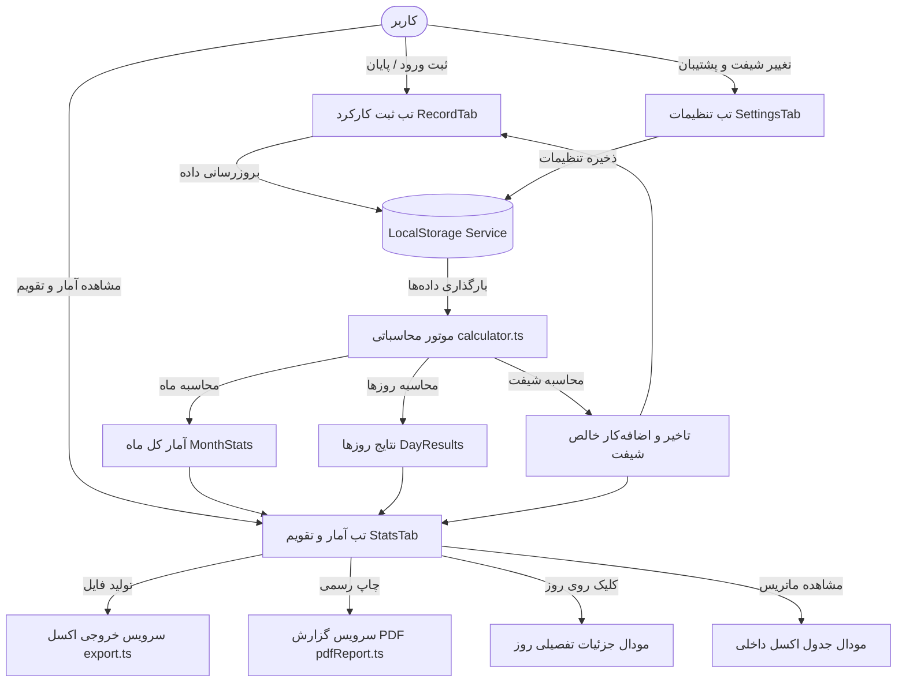
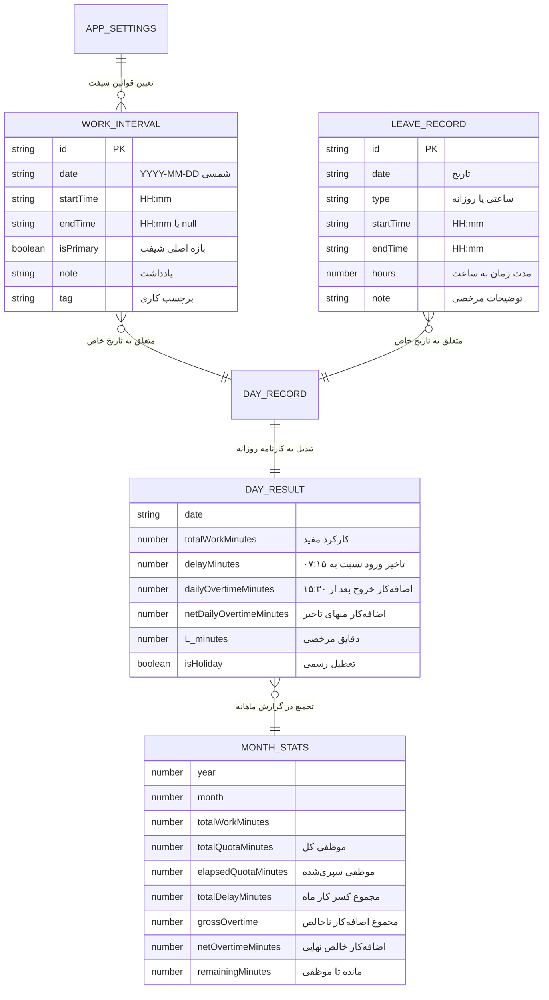

# سند جامع قابلیت‌ها، روابط و معماری سامانه حضور (hozur)

این سند مرجع فنی و عملکردی اپلیکیشن **«حضور» (hozur)** است که به بررسی دقیق تمامی فیچرها (Features)، روابط درونی اجزا، منطق‌های محاسباتی ساعت کاری و شیفت، ساختار داده‌ها و معماری کلی نرم‌افزار می‌پردازد.

---

## ۱. نمای کلی و فلسفه سامانه (Overview)

اپلیکیشن **hozur** یک نرم‌افزار مدیریت زمان، محاسبه کارکرد، مرخصی، تاخیر و اضافه‌کار است که به صورت اختصاصی بر پایه **تقویم هجری شمسی (جلالی)**، پشتیبانی کامل از **راست‌به‌چپ (RTL)** و ذخیره‌سازی محلی و امن روی دستگاه کاربر (Offline-First Local Storage) توسعه داده شده است.

### اهداف بنیادین:
1. **دقت فوق‌العاده در محاسبات زمانی**: ثبت بر مبنای دقیقه و ثانیه بدون خطای گردکردن زودرس.
2. **مدل شیفت اختصاصی سازمانی**: ورود استاندارد در روزهای کاری در ساعت **۰۷:۱۵** و خروج در ساعت **۱۵:۳۰**.
3. **تهاتر خودکار تاخیر و اضافه‌کار**: محاسبه کسر کار تاخیر ورود و کسر آن از کل اضافه‌کار جهت تعیین «اضافه‌کار خالص».
4. **حریم خصوصی و عملکرد آفلاین**: بدون نیاز به سرور واسط یا افشای داده‌های شخصی کارمند.
5. **گزارش‌گیری چندمنظوره**: خروجی PDF رسمی قابل چاپ، خروجی اکسل (XLS و CSV) و پیش‌نمایش جدولی.

---

## ۲. درخت فیچرها و امکانات کلیدی (Feature Breakdown)

```
hozur (سامانه ثبت کارکرد و حضور غیاب)
├── ۱. ماژول ثبت کارکرد روزانه (Record Tab)
│   ├── ۱.۱ ثانیه‌شمار زنده کارکرد (Live Clock & Punch In/Out)
│   ├── ۱.۲ جابجایی بین روزها (روز قبل، روز بعد، بازگشت به امروز)
│   ├── ۱.۳ کارت‌های ۶ گانه پایش روز و ماه
│   │   ├── کارکرد امروز / این روز
│   │   ├── مقدار تاخیر امروز / این روز (ورود بعد از ۰۷:۱۵)
│   │   ├── اضافه‌کار امروز / این روز (خروج بعد از ۱۵:۳۰)
│   │   ├── مقدار تاخیر تا امروز / این روز (تجمعی کسر کار ماه)
│   │   ├── مجموع اضافه‌کار تا امروز / این روز (تجمعی ناخالص ماه)
│   │   └── اضافه‌کار خالص (مجموع اضافه‌کار منهای مجموع تاخیرها)
│   ├── ۱.۴ بازه کاری اصلی و بازه‌های کاری چندگانه (Multiple Work Intervals)
│   │   ├── ثبت ساعت ورود و خروج با انتخابگر ساعت
│   │   ├── برچسب‌گذاری (عادی، ماموریت، دورکاری، شیفت شب)
│   │   └── یادداشت‌گذاری بازه
│   ├── ۱.۵ ثبت و مدیریت مرخصی (ساعتی / روزانه)
│   └── ۱.۶ تشخیص هوشمند کسری کار و پیشنهاد مرخصی ساعتی خودکار
│
├── ۲. ماژول آمار، تقویم و گزارش‌گیری (Stats Tab)
│   ├── ۲.۱ جابجایی و ناوبری ماه‌های شمسی (سال‌های ۱۴۰۳ تا ۱۴۰۶)
│   ├── ۲.۲ کارت‌های ۶ گانه شاخص کلیدی ماه (KPIs)
│   │   ├── کل ساعات کاری ثبت‌شده
│   │   ├── کل ساعات موظفی ماه
│   │   ├── درصد پیشرفت ساعات کاری نسبت به موظفی
│   │   ├── مجموع ساعات مرخصی استفاده‌شده
│   │   ├── اضافه‌کار خالص ماه (پس از تهاتر کسر کار)
│   │   └── ساعات مانده تا تکمیل موظفی
│   ├── ۲.۳ پنل اختصاصی تحلیل تاخیر و اضافه‌کار شیفت (۴ کارت + بنر تهاتر نهایی)
│   ├── ۲.۴ تقویم دیواری ماهانه شمسی با برچسب‌های وضعیت
│   ├── ۲.۵ مودال جزئیات تفصیلی روز (Day Details Modal)
│   ├── ۲.۶ نمودار توزیع کارکرد (کارکرد عادی، اضافه‌کار، مرخصی، مانده)
│   ├── ۲.۷ جدول مشاهده سریع اکسل در درون برنامه (Excel Table Modal)
│   └── ۲.۸ لیست رسمی تعطیلات مناسبتی و هفتگی تقویم ایران
│
├── ۳. ماژول خروجی‌ها و گزارش‌های رسمی (Reporting & Export)
│   ├── ۳.۱ گزارش PDF رسمی قابل چاپ (شامل سربرگ، مهر، امضا، جدول کامل روزها، کارت‌های KPI)
│   ├── ۳.۲ خروجی اکسل استاندارد (.xls) سازگار با مایکروسافت اکسل
│   └── ۳.۳ خروجی CSV با کدگذاری UTF-8 BOM
│
└── ۴. ماژول تنظیمات و پشتیبان‌گیری (Settings Tab)
    ├── ۴.۱ تنظیم ساعات موظفی روزانه و هفتگی
    ├── ۴.۲ تنظیم ساعت پیش‌فرض ورود (۰۷:۱۵) و خروج (۱۵:۳۰)
    ├── ۴.۳ تعیین روزهای تعطیل هفتگی (جمعه، پنج‌شنبه و جمعه)
    ├── ۴.۴ تم نرم‌افزار (روشن، تیره، هماهنگ با سیستم)
    ├── ۴.۵ افکت‌های صوتی ثبت تردد
    └── ۴.۶ پشتیبان‌گیری و بازیابی داده‌ها (JSON Export / Import)
```

---

## ۳. مدل محاسباتی شیفت کاری و قوانین تهاتر (Calculation Model)

### ۳.۱ ساعات مرجع شیفت
در روزهای کاری غیرتعطیل:
* **ساعت استاندارد ورود**: `07:15` (معادل دقیقه ۴۳۵ از آغاز روز)
* **ساعت استاندارد خروج**: `15:30` (معادل دقیقه ۹۳۰ از آغاز روز)

### ۳.۲ فرمول محاسبه تاخیر در ورود (Delay / Tardiness)
برای اولین ورود در یک روز کاری:
$$\text{DelayMinutes} = \max(0, \text{FirstEntryMinutes} - 435)$$

* اگر شخص ساعت `07:15` یا زودتر ورود بزند: **تاخیر = ۰**
* اگر شخص ساعت `08:00` ورود بزند: **تاخیر = ۴۵ دقیقه**
* در روزهای تعطیل رسمی یا جمعه‌ها تاخیر ورود محاسبه نمی‌گردد.

### ۳.۳ فرمول محاسبه اضافه‌کار روزانه (Daily Overtime)
1. **در روزهای کاری غیرتعطیل**:
   کارکرد پس از ساعت `15:30` بدون توجه به اینکه شخص چه ساعتی وارد شده است به عنوان اضافه‌کار در نظر گرفته می‌شود:
   $$\text{DailyOvertimeMinutes} = \sum \max(0, \text{IntervalEndMinutes} - \max(\text{IntervalStartMinutes}, 930))$$
   
2. **در روزهای تعطیل رسمی و جمعه‌ها**:
   تمام دقایق کارکرد به عنوان اضافه‌کار روز تعطیل محاسبه می‌شود:
   $$\text{HolidayOvertimeMinutes} = \text{TotalWorkMinutes}$$

### ۳.۴ فرمول تهاتر تاخیر و تعیین اضافه‌کار خالص (Net Overtime Settlement)
در پایان روز یا تا پایان ماه:
$$\text{GrossOvertime} = \text{NormalOvertime} + \text{HolidayOvertime}$$
$$\text{NetOvertime} = \max(0, \text{GrossOvertime} - \text{TotalDelay})$$

چنانچه مجموع تاخیرها از کل اضافه‌کار بیشتر باشد:
$$\text{UncompensatedDelay} = \text{TotalDelay} - \text{GrossOvertime}$$
(در این حالت اضافه‌کار خالص برابر با صفر بوده و مقدار مازاد به عنوان کسری کار باقی‌مانده ثبت می‌گردد).

---

## ۴. دیاگرام روابط اجزا و جریان داده‌ها (Component Architecture & Flow)

### ۴.۱ جریان داده در اپلیکیشن (Data Flow Diagram)



### ۴.۲ ارتباط بین موجودیت‌های داده (Entity Relationship)



---

## ۵. کارت‌های اختصاصی شیفت و مقایسه عملکرد

| عنوان کارت در رابط کاربری | موقعیت نمایش | فرمول محاسبه | مفهوم تجاری |
| :--- | :--- | :--- | :--- |
| **مقدار تاخیر امروز (یا این روز)** | `RecordTab` و `StatsTab` | $\max(0, \text{Entry}_1 - 07:15)$ | کسر کار ناشی از ورود دیرهنگام به شرکت در همان روز |
| **اضافه‌کار امروز (یا این روز)** | `RecordTab` و `StatsTab` | کارکرد بعد از $15:30$ | اضافه‌کار حاصل از خروج پس از پایان ساعت اداری مصوب |
| **مقدار تاخیر تا امروز** | `RecordTab` و `StatsTab` | $\sum_{d=1}^{\text{امروز}} \text{Delay}_d$ | انباشت کسر کار و تاخیرهای ورود کاربر از ابتدای ماه تا روز جاری |
| **مجموع اضافه‌کار تا امروز** | `RecordTab` و `StatsTab` | $\sum_{d=1}^{\text{امروز}} \text{Overtime}_d$ | کل اضافه‌کار ناخالص تولیدشده توسط کاربر تا انتهای روز جاری |
| **اضافه‌کار خالص (تهاتر شده)** | بنر اختصاصی در هر دو تب | $\max(0, \text{Overtime}_{\text{Total}} - \text{Delay}_{\text{Total}})$ | مانده واقعی طلب اضافه‌کار پرسنل پس از تسویه کامل تاخیرها |

---

## ۶. ساختار فایل‌های پروژه (Codebase Architecture)

```
/
├── index.html                  # مدخل اصلی وب‌اپلیکیشن، تنظیم متاتگ‌ها و عنوان
├── vite.config.ts              # پیکربندی Vite با پلاگین‌های ری‌اکت و Tailwind
├── package.json                # وابستگی‌ها، اسکریپت‌های تست و کامپایل
├── metadata.json               # شناسنامه و متادیتا هوش مصنوعی
├── capacitor.config.ts         # پیکربندی خروجی بومی اندروید (Capacitor)
├── .github/workflows/
│   └── build-apk.yml           # ساخت خودکار و امضای بسته Release APK اندروید
│
└── src/
    ├── main.tsx                # نقطه شروع React و رندر درخت کامپوننت‌ها
    ├── App.tsx                 # کامپوننت ریشه، نگهدارنده وضعیت سراسری، ناوبری تب‌ها
    ├── index.css               # استایل‌های سراسری، فونت وزیرمتن و قوانین راست‌به‌چپ
    │
    ├── types/
    │   └── index.ts            # تعاریف تایپ‌های داده تایپ‌اسکریپت (Interval, Stats, Settings)
    │
    ├── utils/
    │   ├── calculator.ts       # هسته مرکزی محاسبات زمان، تقویم جلالی، تاخیر، شیفت و موظفی
    │   ├── calculator.test.ts  # تست‌های واحد خودکار جامع برای سناریوهای مرزی
    │   └── holidays.ts         # تقویم تعطیلات رسمی و مناسبتی ایران (۱۴۰۳ تا ۱۴۰۶)
    │
    ├── services/
    │   ├── storage.ts          # مدیریت LocalStorage، مایگریشن و ذخیره‌سازی داده‌ها
    │   ├── export.ts           # تولید فایل‌های خروجی اکسل (XLS و CSV)
    │   ├── pdfReport.ts        # قالب‌بندی و تولید گزارش PDF رسمی همراه با چاپ مستقیم
    │   └── sound.ts            # افکت‌های صوتی تعاملی بوق تردد (Web Audio API)
    │
    └── components/
        ├── RecordTab.tsx       # تب ثبت روزانه، ثانیه‌شمار زنده، کارت‌های تاخیر/اضافه‌کار، بازه‌ها
        ├── StatsTab.tsx        # تب آمار، تقویم ماه، کارت‌های KPI، نمودارها و پنل شیفت
        ├── SettingsTab.tsx     # تب تنظیمات ساعت کاری، پیش‌فرض شیفت، تم و پشتیبان‌گیری
        ├── DayDetailsModal.tsx # پنجره پاپ‌آپ مشاهده و ویرایش جزئیات یک روز خاص از تقویم
        ├── ExcelTableModal.tsx # جدول پیش‌نمایش داده‌ها مشابه شیت اکسل درون برنامه
        ├── DeficitLeaveModal.tsx# پاپ‌آپ هوشمند پیشنهاد ثبت مرخصی در زمان خروج زودهنگام
        ├── IntervalModal.tsx   # پنجره افزودن و ویرایش بازه کاری دستی
        └── WorkDistributionPieChart.tsx # نمودار توزیع کارکرد، اضافه‌کار و مرخصی
```

---

## ۷. چرخه حیات و سناریوی کاربردی نمونه (End-to-End Scenario)

1. **شروع روز کاری (مثلاً ساعت ۰۷:۳۵)**:
   * کاربر دکمه بزرگ «ثبت ورود» را لمس می‌کند.
   * سیستم ساعت `07:35` را ثبت کرده و تاخیر ورود را ۲۰ دقیقه محاسبه می‌کند (چون بعد از ۰۷:۱۵ است).
   * کارت **«مقدار تاخیر امروز»** عدد ۲۰ دقیقه را با رنگ هشدار ملایم نمایش می‌دهد.
   * کارت **«مقدار تاخیر تا امروز»** ۲۰ دقیقه افزایش می‌یابد.

2. **پایان روز کاری (مثلاً ساعت ۱۷:۰۰)**:
   * کاربر دکمه «ثبت پایان» را لمس می‌کند.
   * سیستم بازه زمانی خروج را ثبت می‌نماید.
   * از آنجا که خروج در ساعت `17:00` بوده و ساعت مصوب `15:30` است، اضافه‌کار روزانه برابر با **۱ ساعت و ۳۰ دقیقه (۹۰ دقیقه)** محاسبه می‌شود.
   * کارت **«اضافه‌کار امروز»** مقدار ۱ ساعت و ۳۰ دقیقه را نمایش می‌دهد.
   * کارت **«مجموع اضافه‌کار تا امروز»** ۹۰ دقیقه اضافه می‌شود.

3. **تسویه و تهاتر تاخیر (Net Overtime)**:
   * سیستم محاسباتی مجموع تاخیر (۲۰ دقیقه) را از کل اضافه‌کار (۹۰ دقیقه) کسر می‌کند:
     $$90 - 20 = 70 \text{ دقیقه} \quad (\text{معادل ۱ ساعت و ۱۰ دقیقه})$$
   * کارت **«اضافه‌کار خالص»** مقدار **۰۱:۱۰** را به عنوان اضافه‌کار قطعی و قابل پرداخت نمایش می‌دهد.

4. **پایان ماه و ارائه به کارفرما**:
   * کاربر با لمس گزینه **«چاپ گزارش رسمی (PDF)»** در تب آمار، برگه رسمی با جدول ۳۰ روزه، ستون تاخیر ورود، ستون اضافه‌کار و تهاتر نهایی را دریافت و پرینت می‌گیرد.

---

## ۸. نتیجه‌گیری و وضعیت فنی

تمامی نیازمندی‌های مدل جدید شیفت کاری (ورود ۰۷:۱۵، خروج ۱۵:۳۰، کسر تاخیر از اضافه‌کار و نمایش ۴ کارت پایش به علاوه شاخص خالص) در کدهای پروژه تعبیه شده، تست‌های واحد آن با موفقیت ۱۰۰٪ پاس گردیده و با خروجی‌های PDF و اکسل همگام‌سازی کامل شده است.
